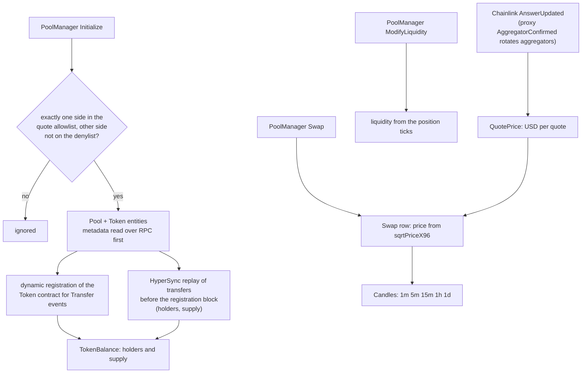

# suitventures-markets-indexer

> **Status: decommissioned 21 Sep 2026. Superseded by the chain reader in the
> [frontend repo](https://github.com/maxlong-markets/suitventures-markets-frontend) (`src/lib/chain/`).**
> This repository is kept public as a documented legacy artefact: it shows the first approach and why it was replaced.
> It is not deployed. (Suggestion: archive the GitHub repo, Settings -> Archive, to make the status obvious.)

An [Envio HyperIndex](https://docs.envio.dev) indexer for MaxLong Markets (then SuitVentures Markets) on Robinhood
Chain (id 4663, an Arbitrum Orbit L2). It discovered every Uniswap v4 pool with one allowlisted quote side (Robinhood
tokenized stocks and USDG), tracked each paired token's holders and supply, built trades, candles and liquidity, and
joined Chainlink stock prices to give USD values. It powered the M1 live-data release (12-16 Sep 2026).

## What it did

- **Pool discovery.** `Initialize` events pass through the one-allowlisted-side rule (`src/lib/primaryPool.ts`,
  `src/handlers/poolManager.ts`); the quote allowlist is `config/quotes.json`, the never-a-memestock list is
  `config/token-denylist.json`, and `config/curated-pools.json` carries origin overrides. A pool's origin (LONG,
  Pons, SUITS, other) comes from `src/lib/origin.ts`.
- **Dynamic token registration.** The `Token` contract has no address in `config.yaml`; each discovered token is
  registered at runtime so its `Transfer` events feed holder balances.
- **Transfer-history replay.** Envio cannot deliver transfers before the block that registered a token, so
  `src/effects/transferHistory.ts` queries HyperSync (`src/lib/hypersync.ts`) for them, capped at 100,000 transfers
  per token, with a 429-aware retry policy.
- **Trades, candles, liquidity.** `Swap` becomes a trade with a price (`src/lib/price.ts`), folded into candles at
  five intervals (`src/lib/candles.ts`); `ModifyLiquidity` feeds in-range liquidity (`src/lib/liquidity.ts`, checked
  against the Uniswap v3 SDK in a test).
- **USD.** Chainlink proxy `AggregatorConfirmed` registers rotated aggregators; `AnswerUpdated` updates the USD price
  of each stock quote. USDG is pinned at 1.

## What survived into the chain reader

The infrastructure was replaced, the arithmetic was not. These modules were written and tested here, then ported:

- the pure fold arithmetic: `price`, `candles`, `liquidity`, `primaryPool`, `origin`;
- the primary-pool rule: one allowlisted side per pool, and the quote allowlist plus denylist that enforce it;
- metadata-before-fold: a token's name, symbol and decimals are read, validated and capped before any trade is
  folded, with a non-cached fallback when a hostile contract reverts or returns garbage.

## Why it was retired

Profiling the deployed indexer on Envio Cloud (16 Sep 2026) showed:

- roughly **130,000 ERC-20 Transfer events per day** across the chain;
- the hosted **Small** plan running at **73-86 % load**;
- a full sync of about **859 million events over about 130,000 contracts**.

Inside the project's USD 70 per month budget that did not fit. On 21 Sep the developer replaced it with a reader that
queries HyperSync directly from a one-minute Vercel cron, folds events with the same pure arithmetic, and writes one
Postgres transaction per batch with a block cursor. It indexes only what the product shows instead of every token's
full transfer history. See the frontend repo for that design.

## Running it again

Nothing here is deployed, but it still builds and tests. Requires Node 24 or newer (developed on 26).

    cp .env.example .env   # add ENVIO_API_TOKEN and a keyed ENVIO_RPC_URL (Alchemy or similar)
    npm install
    npm run codegen
    npm test
    npm run dev            # local Postgres + Hasura via Docker, GraphQL at http://localhost:8080

### Configure

- `config/quotes.json`: the quote allowlist (stock tokens + USDG). `npm run build-quotes` regenerates it from the
  Pons pool snapshot in `data/`; `npm run resolve-feeds` fills the Chainlink aggregator per proxy.
- `config/curated-pools.json`: poolId to origin overrides (SUIT).
- `config/token-denylist.json`: non-stock pairing assets (a wrapped BTC such as cbBTC, and TAO) that must never be
  tracked as a memestock, however they are paired. `npm run build-quotes` regenerates it alongside `quotes.json`.
- `ENVIO_CANDLES_1M_START_BLOCK` / `ENVIO_CANDLES_5M_START_BLOCK`: candle creation windows;
  `npm run block-at -- <unix seconds>` finds a block.

### Validate against a real pool

    ENVIO_TEST_SWAP_BLOCK=61927786 npm run test:live

Checks the indexed AI/NVDA pool (origin LONG, token AI) and a real swap's price against a wide sanity band around the
recent DexScreener price. Needs network and credentials; not part of `npm test`.

### Deploy (historical)

Envio Cloud, from the GitHub repo. Set `ENVIO_RPC_URL`, `ENVIO_API_TOKEN`, `ENVIO_CANDLES_1M_START_BLOCK` and
`ENVIO_CANDLES_5M_START_BLOCK` as environment variables on the deployment.

`ENVIO_API_TOKEN` and `ENVIO_RPC_URL` must both be set before the first sync: the transfer-history replay calls
HyperSync directly, and token metadata is read over RPC. The indexer refuses to start at all without them, rather than
silently skipping pre-registration transfers or falling back to placeholder metadata. A sync that already ran without
`ENVIO_API_TOKEN` needs a full resync once it is set: a token discovered before that point never gets its
pre-registration history.

The Development plan was the M1 demo environment: it deletes a deployment about 10 days after its first sync passes
the 100k-event soft limit (7-day grace, then 3 days read-only), and this indexer passes that limit during its first
sync. Production Small is the next tier, and the one that was profiled above.

Use start blocks `55799704` (1m) and `36074200` (5m) for the first deployment. If the deploy date moves, recompute both
with `npm run block-at` for 7 and 30 days before the deploy, and set `config.yaml`'s ChainlinkAggregator `start_block`
(currently `55799704`) to the new 7-day block too.

## Testing

`npm test` runs 18 vitest files offline (RPC and HyperSync are blanked in `vitest.config.ts`): **160 passed, 1
skipped** (the live test), about 10 s on a warm run. `npm run typecheck` is clean. They cover the fold arithmetic,
candle bucketing, the primary-pool and origin rules, liquidity against the Uniswap v3 SDK, the quote and denylist
loaders, token-metadata edge cases (reverts, bytes32 names, NULs, surrogate pairs, huge strings), HyperSync retry,
pagination and cap behaviour, and the start-up env guard (a spawned real process). A cold, loaded first run timed out
the four env-guard tests; see [SECURITY.md](SECURITY.md) finding L-1. CI (`.github/workflows/test.yaml`) runs codegen,
typecheck and tests on every push.

## Security

Reviewed as a legacy artefact on 27 Oct 2026, not audited. Untrusted token contracts are bounded (length caps,
decimals range, fallbacks), HyperSync use is bounded and keeps the token in a header, scripts have no shell-outs, and
`npm audit --omit=dev` reports 12 findings in Envio's own transitive stack (not upgraded). Details and the findings
table: [SECURITY.md](SECURITY.md).

## Scope and status

- Built: everything described above, through the M1 release. Retired on 21 Sep 2026.
- Not expected: a running deployment, new features, dependency upgrades, or a fix for the audit findings.
- Known limitations: the cost profile above; a token with more than 100,000 pre-registration transfers is capped and marked
  incomplete; no per-request HyperSync timeout.

## Layout

| Path | Contents |
|---|---|
| `config.yaml`, `schema.graphql` | Envio contracts, events and entities |
| `src/handlers/` | `poolManager`, `token`, `chainlink`, `shared` event handlers |
| `src/effects/` | `tokenMetadata` (RPC), `transferHistory` (HyperSync replay) |
| `src/lib/` | pure logic: `price`, `candles`, `liquidity`, `primaryPool`, `origin`, `quotes`, `denylist`, `hypersync` |
| `scripts/` | `block-at`, `build-quotes`, `resolve-feeds` developer tools |
| `config/`, `data/` | allowlist, denylist, curated pools; Pons and Chainlink snapshots |
| `.github/workflows/test.yaml` | CI |

## Links

- Live system and chain reader: https://github.com/maxlong-markets/suitventures-markets-frontend
- Umbrella repo, Decision Log: https://github.com/maxlong-markets/suitventures-markets
- Product: https://www.maxlong.markets
